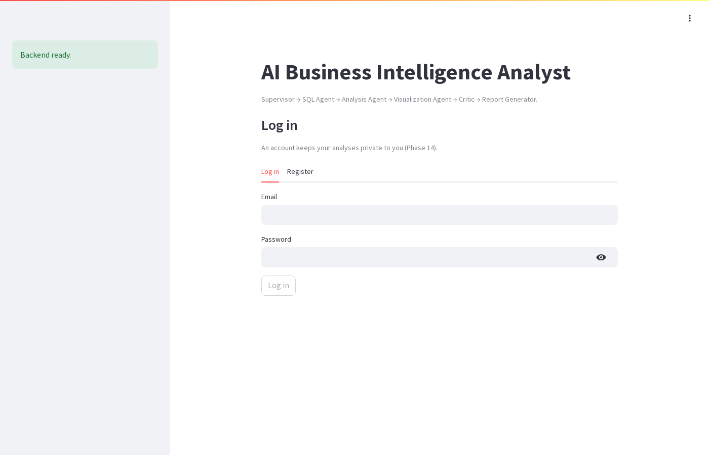
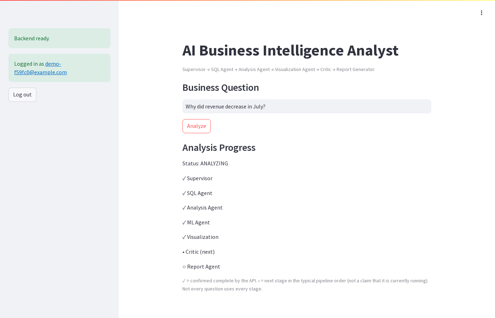
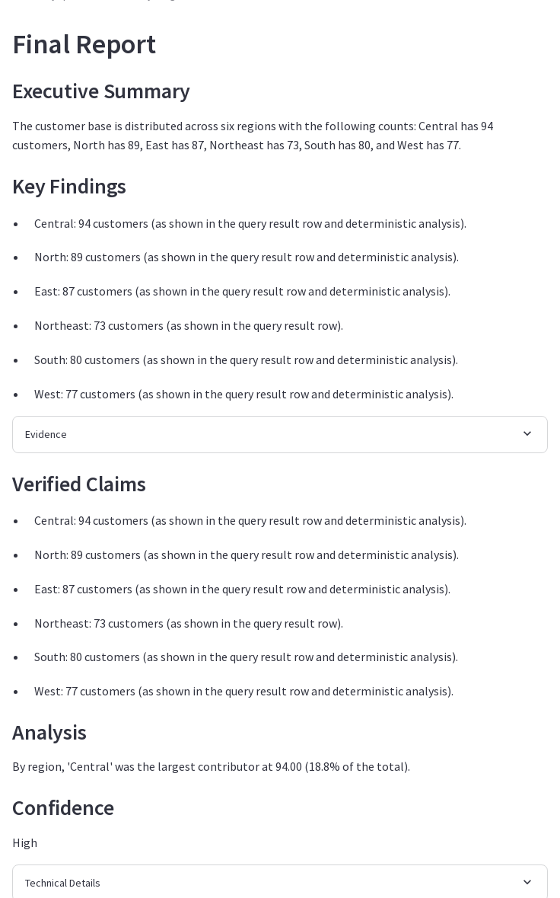
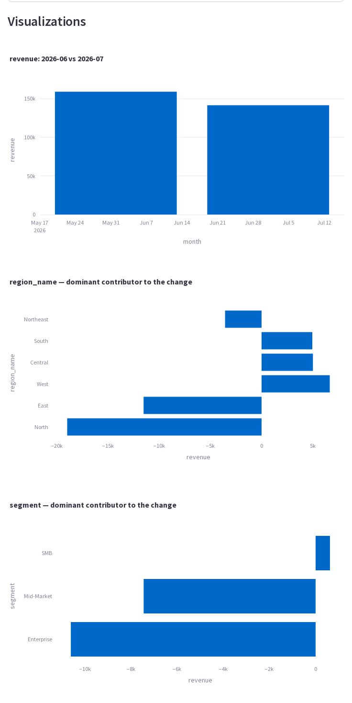
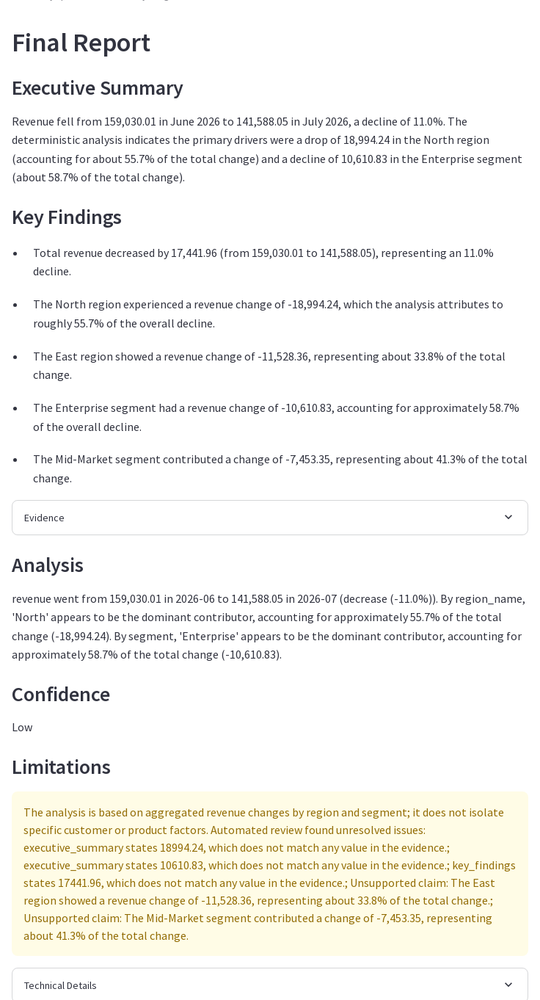
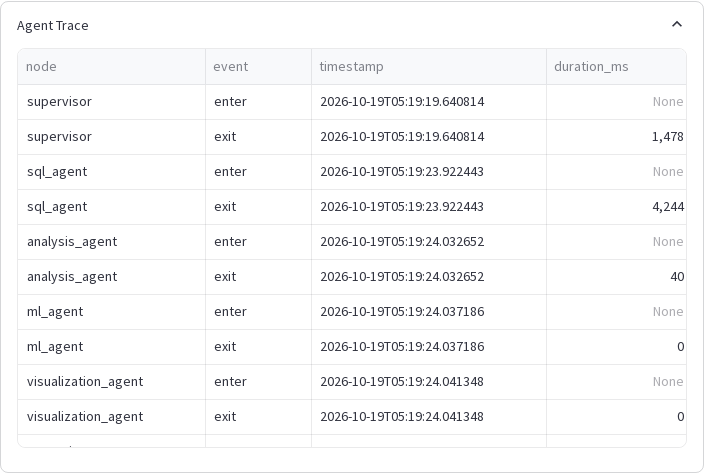
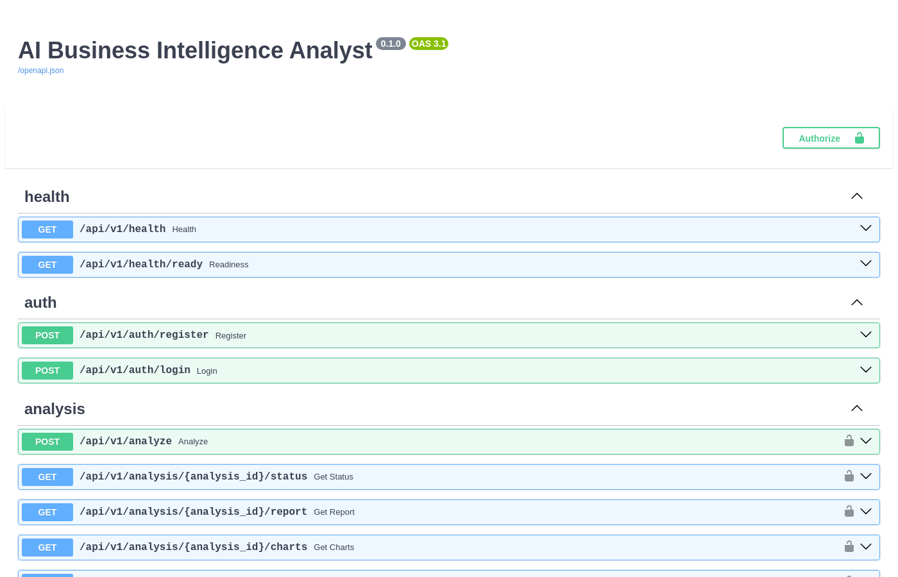
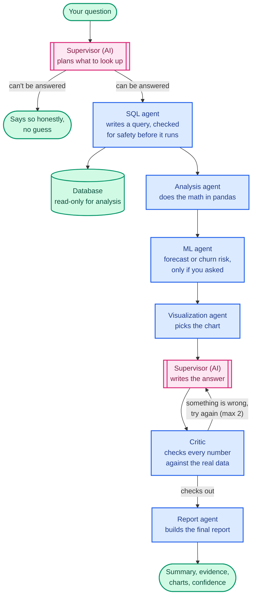

<div align="center">

# AI Business Intelligence Analyst

**Ask a business question in plain English. Get an answer built on real numbers and checked before you see it.**

[](https://github.com/sunilsaini01/AI-Business-Intelligence-Analyst/actions/workflows/ci.yml)
[](https://www.python.org/)
[](https://fastapi.tiangolo.com/)
[](https://github.com/langchain-ai/langgraph)
[](https://www.postgresql.org/)
[](https://streamlit.io/)
[](https://scikit-learn.org/)
[](https://www.docker.com/)
[](https://aibia-frontend.onrender.com)


[Overview](#overview) · [Live demo](#try-it-live) · [Features](#key-features) · [Screenshots](#screenshots) · [How it works](#how-it-works) · [Results](#results) · [Security](#security-and-reliability) · [Getting started](#getting-started) · [API](#api) · [Tests](#testing) · [Deployment](#deployment-on-render) · [Limitations](#limitations) · [Docs](#documentation)

</div>

---

## Overview

Business teams ask the same kinds of questions all the time: *Why did revenue drop last month? Which products sell best? How many customers do we have in each region? Who might stop buying from us?* Usually someone has to write database queries and build charts by hand to answer them.

**AI Business Intelligence Analyst** lets you just type the question. A team of AI agents then does the work:

1. It **plans** what data is needed. If the data can't answer the question, it says so instead of guessing.
2. It **looks up real data** with safe, read-only database queries.
3. It **does the math in normal code** (pandas). The AI never calculates numbers itself.
4. It **makes forecasts and churn predictions** with a small statistics model, but only when you ask about the future.
5. It **picks a fitting chart** automatically.
6. A **second AI check (the "Critic")** compares every number and claim in the answer with the real data. If something doesn't match, the answer is sent back to be fixed, up to two times.
7. You get a **final report**: a short summary, key findings, evidence, charts, recommendations, and how confident it is.

The AI only plans and writes the words. The numbers, the charts and the final check are all done by plain code.

> **Data notice.** No real company data is used. The main dataset is **synthetic** (a made-up company, created by a script with a fixed random seed). It has a planned revenue drop in July 2026, so the question *"Why did revenue decrease in July?"* always has a real answer that can be checked. A second, separate dataset is the public **Olist** Brazilian e-commerce dataset (about 1.3 million rows), used for messier, real-world questions. The two datasets are kept apart and never mixed.

---

## Try it live

- **App:** **[aibia-frontend.onrender.com](https://aibia-frontend.onrender.com)**. Create a free account (any email and password) and ask a question.
- **API docs:** [aibia-api.onrender.com/docs](https://aibia-api.onrender.com/docs)

The demo runs on a free hosting plan. If nobody has used it for a while, the first page can take **30–60 seconds** to wake up. If it looks stuck, wait a little and refresh.

**Good first questions:**
- *"Why did revenue decrease in July?"*
- *"How many customers do we have per region?"*
- *"What are our top 5 products by revenue?"*
- *"Show me the monthly revenue trend."*
- *"Forecast revenue for next month."*
- *"Which customers are at risk of churning?"*

---

## Key features

| Feature | What it does | How it was checked |
|:---|:---|:---|
| **Plain-English questions** | You type a normal question; no need to know how the database is set up | Real-browser tests that log in, ask a question and read the report |
| **Honest "I can't answer that"** | If the data can't answer the question, it says so and stops, instead of making something up | Tests with off-topic questions (for example, "What's the weather like today?") |
| **Safe database lookups** | AI-written queries are checked before they run: only one `SELECT`, only allowed tables, a row limit, and a time limit | Attack tests: stacked queries, hidden keywords, writes disguised as a query, and blocked tables |
| **Math in real code** | Totals, changes, shares and "what caused the drop" are worked out with pandas, not by the AI | Unit tests on the analysis tools, plus answers compared with known correct values |
| **Forecasts and churn risk** | A trend line for future revenue, and a logistic-regression model for customers at risk of leaving | Fixed pass marks: forecast error ≤ 25%, churn ROC-AUC ≥ 0.65; checked for data leakage |
| **Automatic charts** | Chooses a fitting chart (for example a bar or line chart) for the result, or no chart when none helps | Tests on the chart picker and on chart labels matching the data |
| **The Critic** | Checks every number in the answer against the real data, re-checks the math, and flags claims the evidence doesn't support | Mutation tests: a fake number and a made-up cause are slipped in, and the Critic must catch both |
| **Final report** | Summary, key findings, evidence, charts, recommendations, confidence level and limits | Report fields are tested end to end |
| **Accounts and privacy** | Each user logs in and can only see their own analyses and reports | Tests that one user cannot read another user's data, even with many requests at once |
| **Progress tracking** | The app shows which step the analysis is on, and a page refresh does not lose your progress | Frontend polling tests |
| **Built-in benchmark** | A set of 7 test questions with known correct answers, to measure quality over time | Results are saved per run so changes can be compared |

---

## Screenshots

| | |
|:---:|:---:|
|  |  |
| **Login:** each user has their own private account | **Progress:** each step is ticked off as the API confirms it |
|  |  |
| **Report:** every claim verified, confidence High | **Charts:** picked automatically, here showing what drove the July drop |
|  |  |
| **The Critic at work:** numbers the AI wrote that don't match the data are flagged, and confidence drops to Low | **Agent trace:** every step, with timings |



*Interactive API docs at `/docs`.*

*Screenshots from a local run with the synthetic data and the Groq AI provider.*

---

## How it works



*Pink = an AI is involved. Blue = plain code with no AI. Green = input, output and data.*

**In short:**
- **The frontend** (Streamlit) only shows things and sends requests. **The backend** (FastAPI) holds all the logic and runs the agents with LangGraph.
- **Asking a question works in two steps.** The app sends your question and gets an ID back right away. It then checks every 2 seconds until the answer is ready, so you never wait on one long request.
- **The database protects itself.** The connection used for analysis belongs to a database user that is only allowed to read. Even if every other check had a bug, the database would still refuse any change.
- **The Critic is mostly plain code.** It uses one small AI call for the only question code can't answer: "does this wording claim more than the facts show?" If that AI call fails, it is noted, but the answer is not marked wrong.
- **If the Critic still finds problems after two retries,** the report is shown with confidence set to "Low" and a note saying the check did not fully pass. It never hides this.

More detail: [docs/architecture.md](docs/architecture.md).

---

## Results

All numbers come from real runs.

| Question | Result | Source |
|:---|:---|:---:|
| **Do the tests pass?** | **569 of 570** passed. The one that didn't was a test that needs a live AI provider, and the free daily limit had been reached at that moment. It is reported, not hidden. | [Testing](#testing) |
| **Does the Critic catch made-up answers?** | Yes. When a fake number or an unsupported cause was slipped into a real report, the Critic caught it every time. | [details](docs/evaluation.md#critic-effectiveness) |
| **Is the revenue forecast accurate enough?** | Average error (MAPE) about **11%**. The pass mark is 25% or less. | [details](docs/evaluation.md#ml-agent-evaluation-phase-16) |
| **Is the churn prediction useful?** | ROC-AUC about **0.82** (0.5 would be a coin flip; the pass mark is 0.65). Accuracy about 75%, precision about 76%, recall about 73%. | [details](docs/evaluation.md#ml-agent-evaluation-phase-16) |
| **Does the "why did revenue drop?" answer point to the right cause?** | Yes. In the data, revenue fell from $161,445.80 in June 2026 to $150,633.02 in July (−6.7%), and the Enterprise customer group's decline makes up 98% of that drop. The system names the Enterprise segment and the North region as the main drivers. This is also checked automatically by the tests. | [details](docs/architecture.md) |
| **Does it work in a real browser?** | **5 of 5** browser tests passed (real login, real clicks, real report). | [Testing](#testing) |

**Other things that were checked:**

| Check | Result |
|:---|:---|
| Can someone send dangerous database commands through the chat box? | No. Several attack styles were tried; all were blocked. |
| Does the site reject people who are not logged in? | Yes. |
| Can one user see another user's analyses? | No, including when many users send requests at the same time. |
| Does the health check report a broken database? | Yes. A real bug was found and fixed: it used to say "healthy" even when the database was down. |
| Does it ever show a password or API key in logs or error messages? | No. Checked across logs, error messages and crash reports. |

---

## Security and reliability

| Area | What is in place |
|:---|:---|
| **Read-only analysis** | Analysis queries use a separate database user (`readonly_analyst`) that can only read the `analytics` and `olist` data. This is enforced by the database itself. |
| **Query checks** | Before a query runs, it is parsed and checked: one `SELECT` only, only allowed tables and columns, a row limit (5,000), an 8-second time limit, and a read-only transaction. Each query is logged (its hash, tables, row count and time, never the rows). |
| **Login** | Passwords are stored as bcrypt hashes. Logins return a signed token (JWT) that lasts 24 hours by default. A wrong email and a wrong password get the same message, so no one can find out which emails are registered. |
| **Too many login tries** | After 5 tries in 5 minutes for the same IP and email, login is blocked for a while (HTTP 429). |
| **Privacy between users** | Every analysis belongs to the user who created it. Other users get "forbidden" (403). |
| **Secrets** | `.env` is never committed. Secret settings are hidden from logs and error output. Error messages sent to users are short, fixed texts, never raw errors. |
| **Key rotation** | The token-signing key can be changed without logging everyone out. The old key keeps working for existing logins until you remove it. Steps are in [docs/security.md](docs/security.md). |
| **CORS** | Only the real frontend address is allowed, never `*`. |
| **AI errors** | Short-lived AI provider errors are retried automatically (up to 2 times). Failures are sorted into types (rate limit, timeout, provider error and so on) and saved with the run. |
| **Run details** | Each run saves its start and end time, duration, finished steps, retry count, token use and error type. No secrets are ever stored there. |

---

## Technology

| Layer | Technology |
|:---|:---|
| **AI orchestration** | LangGraph (a supervisor plus SQL, analysis, ML, chart, critic and report agents) |
| **AI models** | Anthropic Claude or Groq. Choose one with `LLM_PROVIDER`; no code change needed |
| **Backend** | Python 3.11, FastAPI, Pydantic, SQLAlchemy (async), Alembic (4 database migrations) |
| **Database** | PostgreSQL 16 |
| **Query safety** | sqlglot (checks the structure of every query before it runs) |
| **Data analysis** | pandas, NumPy |
| **Machine learning** | scikit-learn (linear trend for forecasts, logistic regression for churn) |
| **Charts** | Plotly |
| **Frontend** | Streamlit |
| **Login** | JWT tokens (PyJWT) and bcrypt password hashing |
| **Testing** | pytest, Playwright (real browser) |
| **CI** | GitHub Actions: tests against a real PostgreSQL database and Docker builds on every push |
| **Hosting** | Docker Compose (local), Render (live demo) |

---

## Project structure

```text
AI-Business-Intelligence-Analyst/
├── app/
│   ├── agents/          # The AI agents: supervisor, SQL, analysis, ML, visualization, critic, report
│   ├── api/routes/      # API endpoints: auth, analysis, reports, evaluation, health
│   ├── core/            # Settings, login, AI provider clients, logging, error types
│   ├── db/              # Database models and migrations (Alembic)
│   ├── evaluation/      # Benchmark runner and quality scores
│   ├── graph/           # The LangGraph workflow that connects the agents
│   ├── schemas/         # Request and response shapes
│   ├── services/        # Business logic for analyses, reports, login and evaluation
│   ├── tools/           # Plain-code tools: safe queries, math, charts, ML, critic checks
│   └── main.py          # FastAPI app entry point
├── frontend/            # Streamlit web app (login, ask a question, view the report)
├── scripts/             # Create and load data, run the benchmark, smoke test
├── data/seeds/          # Synthetic company data (CSV files)
├── evaluation/datasets/ # Benchmark questions with known correct answers
├── tests/               # unit, agents, api, integration, security, evaluation, frontend, e2e
├── docs/                # Architecture, API, security, evaluation and deployment docs (+ screenshots)
├── .github/workflows/   # CI: tests and Docker builds on every push
├── docker-compose.yml   # Local stack: database, API and frontend
├── render.yaml          # Render deployment setup
└── .env.example         # Configuration template
```

---

## How the data is organized

One database, three separate areas, each with its own access rules:

| Area | Access | What's in it | Purpose |
|:---|:---|:---|:---|
| `app` | Read and write, backend only | Users, analysis sessions and steps, reports, charts, evaluation runs and results | The app's own records. **The AI never queries this area.** |
| `analytics` | **Read-only** | A synthetic company: 6 regions, 500 customers, 60 products, 1,264 orders, 3,139 order items, 1,226 payments, 60 marketing campaigns and 11,343 customer activity rows | The main dataset. It has a planned revenue drop in July 2026 so the demo question has a checkable answer. |
| `olist` | **Read-only** | The real Olist Brazilian e-commerce dataset (about 1.3 million rows in 9 tables): customers, sellers, products, orders, order items, payments, reviews, locations | Messier, real-world questions. |

The `olist` data is kept separate on purpose. It has no "region" or "customer segment" in the source, and filling those in would mean inventing data.

---

## Getting started

### Requirements
- [Docker Desktop](https://www.docker.com/products/docker-desktop/)
- One AI provider key: [Anthropic](https://console.anthropic.com) or a free [Groq](https://console.groq.com) key
- Optional: the [Olist dataset](https://www.kaggle.com/datasets/olistbr/brazilian-ecommerce) CSV files in `data/raw/`, for the Olist questions

### Installation (Docker, recommended)

```bash
# 1. Get the code
git clone https://github.com/sunilsaini01/AI-Business-Intelligence-Analyst
cd AI-Business-Intelligence-Analyst

# 2. Create the configuration file
cp .env.example .env
#    Set your AI key (ANTHROPIC_API_KEY or GROQ_API_KEY + LLM_PROVIDER=groq)
#    Set SECRET_KEY:  python -c "import secrets; print(secrets.token_hex(32))"

# 3. Start the database, API and frontend
docker compose up --build

# 4. First time only: create the tables and load the sample data
docker compose exec api alembic upgrade head
docker compose exec api python scripts/generate_data.py
docker compose exec api python scripts/seed_database.py
#    Optional, if you added the Olist CSV files:
docker compose exec api python scripts/load_olist.py
```

Then open:
- **App:** http://localhost:8511
- **API docs:** http://localhost:8010/docs

### Without Docker

```bash
python -m venv .venv && . .venv/Scripts/activate     # on Mac/Linux: source .venv/bin/activate
pip install -r requirements.txt
cp .env.example .env                                 # point the database URLs at your own PostgreSQL
alembic upgrade head
python scripts/generate_data.py
python scripts/seed_database.py
uvicorn app.main:app --reload
```

### Configuration

All settings are environment variables in `.env` (template: [.env.example](.env.example)). The most important ones:

| Variable | Purpose |
|:---|:---|
| `POSTGRES_PASSWORD`, `DATABASE_URL` | Main database connection (read and write) |
| `READONLY_DB_PASSWORD`, `ANALYTICS_DATABASE_URL` | Read-only connection used for analysis |
| `LLM_PROVIDER` | `anthropic` or `groq` |
| `ANTHROPIC_API_KEY` / `GROQ_API_KEY` | The key for the provider you chose |
| `SECRET_KEY` | Signs login tokens (required, no default) |
| `ACCESS_TOKEN_EXPIRE_MINUTES` | How long a login lasts (default 1440 = 24 hours) |
| `CRITIC_MAX_RETRIES` | How many times the Critic can send an answer back (default 2) |
| `REPORT_NARRATIVE_ENABLED` | Adds an optional AI-polished summary (default `false`) |
| `LOGIN_RATE_LIMIT_MAX_ATTEMPTS`, `LOGIN_RATE_LIMIT_WINDOW_SECONDS` | Login try limit (defaults 5 tries per 300 seconds) |
| `FRONTEND_ORIGIN`, `API_BASE_URL` | Allowed frontend address, and the API address the frontend uses |

---

## API

Everything goes through a REST API at `/api/v1`. Asking a question takes two steps: **send the question, then check back for the answer**.

| What you can do | Endpoint | Login needed |
|:---|:---|:---:|
| Create an account | `POST /auth/register` | No |
| Log in and get a token | `POST /auth/login` | No |
| Ask a question | `POST /analyze` | Yes |
| Check if it's done | `GET /analysis/{id}/status` | Yes |
| Get the finished report | `GET /analysis/{id}/report` | Yes |
| Get the charts | `GET /analysis/{id}/charts` | Yes |
| Get the full run details and step trace | `GET /analysis/{id}` | Yes |
| List your past reports | `GET /reports` | Yes |
| Run the benchmark | `POST /evaluation/run` | No |
| See benchmark results | `GET /evaluation/results` | No |
| Check the server is up / ready | `GET /health`, `GET /health/ready` | No |

You only ever get **your own** analyses back. Interactive docs where you can try every endpoint are at `/docs` (locally http://localhost:8010/docs). Full details: [docs/api.md](docs/api.md).

---

## Testing

| Suite | What it covers |
|:---|:---|
| `tests/unit/` | Query checks, math tools, chart picker, ML tools, Critic checks, login, error types |
| `tests/agents/` | Each agent on its own, using a scripted fake AI |
| `tests/api/` | API endpoints, login, ownership, health checks, run details |
| `tests/integration/` | The full agent workflow against the real seeded database |
| `tests/security/` | SQL attacks, access control, login limits, secret leaks, safe errors |
| `tests/evaluation/` | Benchmark loading, scoring, failure sorting, ML quality gates |
| `tests/frontend/` | API client, progress polling, report view, charts, bad responses |
| `tests/e2e/` | Real-browser tests with Playwright (run separately) |
| **Total** | **570 tests, 569 passing** |

Most tests use a scripted fake AI, so they need **no API key** and use no AI quota. Only four test files call a real AI provider.

**Every push to GitHub runs CI** ([ci.yml](.github/workflows/ci.yml)). It starts a fresh PostgreSQL 16 database, creates the tables, loads the synthetic data, runs **563 tests**, and builds both Docker images. It skips the four live-AI test files, plus one test that needs the Olist data (which is not in the repository).

**Run all tests without an AI key:**
```bash
docker compose exec api python -m pytest tests/ -q \
  --deselect tests/agents/test_critic_live_llm.py \
  --deselect tests/agents/test_report_agent_live_llm.py \
  --deselect tests/api/test_analyze_live_llm.py \
  --deselect tests/api/test_evaluation.py
```

**Run the benchmark from the command line** (saves a JSON report in `evaluation/reports/`):
```bash
docker compose exec api python scripts/run_evaluation.py
```

The browser tests use a fake AI (`LLM_PROVIDER=fake`) so they give the same result every time. The exact commands are at the top of [tests/e2e/test_analysis_journey.py](tests/e2e/test_analysis_journey.py).

---

## Deployment on Render

The live demo runs on [Render](https://render.com)'s free plan, set up from [render.yaml](render.yaml):

```text
Render
├── aibia-postgres   PostgreSQL database
├── aibia-api        FastAPI backend + AI agents (Docker)
└── aibia-frontend   Streamlit app (Docker), talks to the API over HTTPS
```

**Steps in short:**
1. Create a new Blueprint on Render from this repository. It creates the database and both services.
2. Set the two database URLs (`DATABASE_URL` and `ANALYTICS_DATABASE_URL`) by hand.
3. Set your AI key (`GROQ_API_KEY`, or `ANTHROPIC_API_KEY` with `LLM_PROVIDER=anthropic`).
4. Run the database migrations once from your own computer. The free plan can't run them on Render.
5. Load the sample data once, the same way.
6. Check that the frontend and API addresses in `render.yaml` match the ones Render gave you.

Render only sends traffic to the API when `/api/v1/health/ready` says the database is reachable.

Full guide: [docs/deployment.md](docs/deployment.md).

---

## Limitations

This is a portfolio project. Its known limits are stated openly:

- **Data:** the main dataset is synthetic (a made-up company). The Olist dataset is real but separate. The results do not describe any real business.
- **Forecasts** use a simple trend line. They won't see a sale, a holiday or a one-off event coming.
- **"At risk of churning"** shows a pattern in the data, not the reason why. The system is built never to claim it knows the cause.
- **"Churn"** is defined as no order in 180 days. That is a modelling choice, not something customers told us.
- **Free hosting limits:** the site can take up to a minute to wake up, the free database expires after a while, and the free AI tier has a daily limit that heavy testing can use up.
- **Login try limit** works on one server only. With several servers, each one would count tries on its own.
- **Accounts:** there is no password reset or email check.
- **Live AI answers can vary between runs.** For example, the AI may write a slightly different query or pick different months. When the summary's numbers don't match the data, the Critic flags them, lowers confidence and lists the problem under Limitations (see the [screenshot](#screenshots)).
- **The optional AI-polished summary** is extra. If it can't be checked against the data, it is dropped, and you still get the checked summary.
- **The benchmark is small** (7 questions). It catches regressions but does not prove the system is right on every possible question.

---

## Documentation

| Document | Contents |
|:---|:---|
| [architecture.md](docs/architecture.md) | How the parts fit together, design decisions, and bugs found and fixed |
| [api.md](docs/api.md) | Every API endpoint, login and ownership rules, the ML agent output |
| [security.md](docs/security.md) | Every security layer, secret handling and key rotation steps |
| [evaluation.md](docs/evaluation.md) | How quality is measured, pass marks and the reasons for them |
| [deployment.md](docs/deployment.md) | Step-by-step Render deployment |

---

## Acknowledgements and license

- **Brazilian E-Commerce Public Dataset by Olist**, via [Kaggle](https://www.kaggle.com/datasets/olistbr/brazilian-ecommerce). The dataset is not included in this repository; download it under its own terms.
- The `analytics` dataset is synthetic and created by [scripts/generate_data.py](scripts/generate_data.py).

No open-source license has been chosen yet, so all rights are reserved by default.

<div align="center">

Built by [@sunilsaini01](https://github.com/sunilsaini01)

</div>
